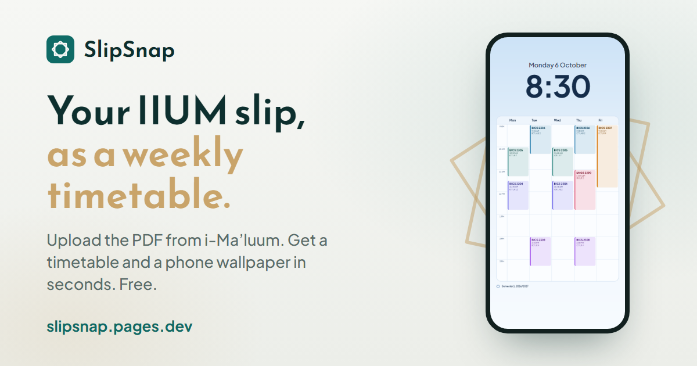

# SlipSnap

**Turn your IIUM confirmation slip into a weekly timetable and phone wallpaper.**

*Formerly IIUM Schedule Converter.*

SlipSnap (formerly IIUM Schedule Converter, also called IIUM Timetable) reads the IIUM Course Registration Confirmation Slip you download from [i-Ma'luum](https://imaluum.iium.edu.my/home) and lays your classes out as a weekly schedule. You can recolor each course and save it as a timetable image or as a lock screen wallpaper sized for your phone or iPad.

> [!NOTE]
> This is an unofficial student project and is not affiliated with the International Islamic University Malaysia (IIUM).

**Open it: https://slipsnap.pages.dev/**

This repo also keeps the old address (`tepjey.github.io/iium-schedule-converter`) working: it sends visitors, and their saved settings, to SlipSnap. The source code is private.

## Features

- **Wallpaper or timetable.** Save a lock screen wallpaper that keeps the top of the screen clear for the clock, or a wide timetable image for sharing and printing.
- **Sized for your device.** Presets for iPhones, popular Android phones (Samsung Galaxy, Xiaomi, Redmi and more) and iPads in portrait or landscape. On a phone, *Match this device* sizes it to your screen.
- **Themes.** Three light themes (Limestone, Sakura, Mint) and three dark ones (Midnight, AMOLED, Ocean), with a 12-hour or 24-hour clock and a choice of fonts.
- **Your colors.** Tap any course to give it a color from the palette.
- **Theme Studio.** Make your own theme from one color or fine-tune every one, with gradient backgrounds, see-through cards and grid options. Share a theme with friends as a link.
- **Private.** Your slip is read on your device and never uploaded.
- **Works on phones.** Saving uses the share sheet on iPhone and Android, with a fallback for Instagram, TikTok and other in-app browsers.

## SlipSnap Pro

Everything above is free and stays free. SlipSnap Pro is an optional **RM5 one-time** unlock for the Theme Studio's extras:

- Photo backgrounds with blur and frosted glass
- Stickers and sticky notes
- Extra fonts and class block styles
- Liquid Glass wallpapers: the timetable as panes of frosted glass, like iOS 26
- A next-class widget for the iPhone home and lock screen, through the free [Scriptable](https://scriptable.app) app

Anyone can try every Pro feature; Pro is only needed to save an image that uses one. See the [terms](https://slipsnap.pages.dev/terms), [refund policy](https://slipsnap.pages.dev/refunds) (14 days, no questions asked) and [privacy policy](https://slipsnap.pages.dev/privacy).

## How to use

1. Open the **[confirmation slip page](https://imaluum.iium.edu.my/MyAcademic/confirmation-sem)** and log in to **i-Ma'luum** if asked.
2. Choose your session and semester, then click **Submit**.
3. Click **Print** and save it as a PDF.
4. Open **[SlipSnap](https://slipsnap.pages.dev/)** and upload that PDF.
5. Pick a layout, theme and colors, then tap **Save**.

On iPhone, choose **Save Image** in the share sheet to put the wallpaper in Photos. Then open **Settings → Wallpaper** to set it.

## Privacy

- **Your slip stays on your device.** The PDF is read in your browser. Nothing from it, including your name, matric number and IC number, is sent to any server.
- **Preferences stay in your browser.** Theme, layout, custom themes and photos are saved in your browser's storage.
- **Pro purchases.** Stripe handles payments; SlipSnap never sees your card or bank details. No account is needed.
- **Anonymous visit counting.** [GoatCounter](https://www.goatcounter.com) counts visits without cookies or cross-site tracking.

Full details: [privacy policy](https://slipsnap.pages.dev/privacy).

## Something not working?

Use the **Report a problem** link on the site; it starts an email with the error already filled in. Nothing is sent unless you send it yourself.

> [!IMPORTANT]
> Please **don't attach your confirmation slip** or post it in an issue. It shows your IC and matric number, and issues are public. Typing out the affected row is enough.

## Supporting the project

SlipSnap is free for every IIUM student, and it always will be. If it saved you time, you can [buy me a coffee on Ko-fi](https://ko-fi.com/athifuzair) or get SlipSnap Pro. Telling a friend about the site helps just as much.

## License

All rights reserved © 2026 [tepjey](https://github.com/tepjey) · [LinkedIn](https://www.linkedin.com/in/a%E2%80%99thif-uzair-5194a0389/).
